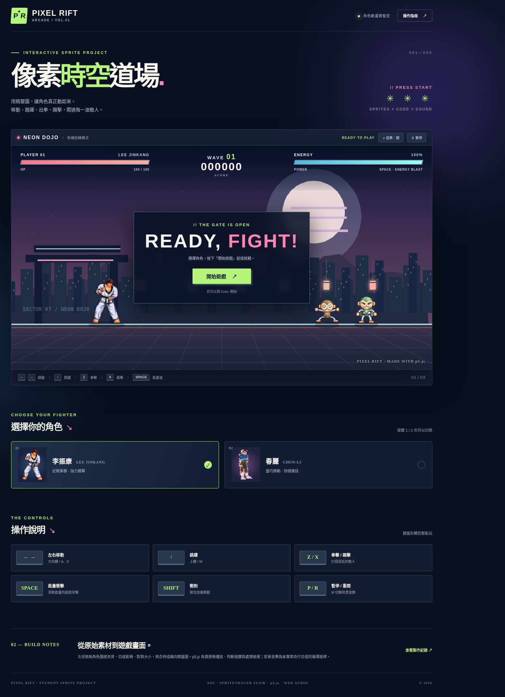

# PIXEL RIFT｜像素時空道場

使用五張上傳的角色素材、p5.js 動畫與原創音樂製作的單頁街機格鬥網頁。手機可用畫面底部觸控鍵，桌面用鍵盤。

## 啟動方式（VS Code）

0. 想先直接試玩：可雙擊 `offline-preview.html`，它把角色圖片、音樂與本作品所需的離線相容繪圖功能包在同一份 HTML 裡；正式作品請使用 `index.html`（優先載入官方 p5.js）。
1. 解壓縮後，開啟 VS Code → **檔案 → 開啟資料夾** → 選擇 `pixel-rift-dojo`。
2. 建議安裝 **Live Server** 擴充功能；對 `index.html` 按右鍵 → **Open with Live Server**。
3. 開啟瀏覽器看遊戲。如果沒有網路，本專案 `vendor/p5-local.js` 可在官方 p5.js CDN 無法載入時，提供本作品需要的簡化繪圖介面；正常上線則優先使用官方 p5.js 1.9.0。
4. 按「開始遊戲」或 Enter。按「♫ 音樂」啟動原創配樂。

> 雙擊 HTML 開啟可能受到瀏覽器本機圖片權限限制，請使用 Live Server 或 `python -m http.server 5500`。

## 遊戲按鍵

| 按鍵 | 功能 |
|---|---|
| ← / →、A / D | 左右移動 |
| ↑ / W | 跳躍 |
| Z | 拳擊 |
| X | 踢擊 |
| Space | 能量波（消耗 22 能量） |
| Shift | 衝刺 |
| 1 / 2 | 切換李振康／春麗 |
| P | 暫停／恢復 |
| R | 重新開始 |
| M | 開關背景音樂 |

## 資料夾

- `assets/originals/`：五張用戶提供的來源圖片。
- `assets/sheets/`：17 張含透明背景的橫向精靈圖。
- `1/`～`5/`：老師教材風格的角色／動作資料夾，每個動作有 `0.png` 開始的分格，以及同名合併長條圖。
- `assets/sprite-data.json`：每個動作的長條總寬、高、影格數、單格寬。
- `assets/audio/dojo-loop.wav`：自行程式合成的 16 秒循環音樂。
- `docs/`：**兩份已處理 MD**、切圖成果說明圖、實際網頁測試截圖。
- `tools/prepare_sprites.py`：用 Pillow 重現本次切圖合併流程；**不是 ASU 或 SpriteTracer 本身**。
- `vendor/p5-local.js`：離線簡化相容繪圖器；正式有網路時優先使用 CDN 的 p5.js。
- `offline-preview.html`：雙擊即可測試的單檔版本，不取代 `index.html` 的官方 p5.js 正式版。

## 發布到 GitHub Pages

**目前還未使用你的帳號建立 Repository，也尚未取得公開網址。**

1. 登入 GitHub，點右上角 **+ → New repository**，例如設定 `pixel-rift-dojo`，設為 Public（公開前確認素材授權）。
2. 將專案**資料夾內所有檔案**上傳至該 Repository 根目錄，包括 `.nojekyll`。不要把整份 ZIP 當成唯一檔案上傳。
3. 到 Repository → **Settings → Pages**，在 **Build and deployment** 選 **Deploy from a branch**，Branch 設為 `main`、資料夾為 `/(root)`，按 Save。
4. 等 GitHub Pages 顯示正式網址，再把它填進 `docs/學生版_角色動畫製作紀錄_已填寫.md` 的基本資料欄及繳交確認欄。
5. 常見網址格式：`https://你的帳號.github.io/pixel-rift-dojo/`（**這只是格式示例，不是已發布的真實網址**）。

## 作業、授權與實作證明

五張角色圖是課堂作業參與者提供，下載來源／使用權利尚待確認；公開前請確認作者、授權與標示方式。原始素材的部分圖片包含遊戲作品／擷取者名稱，不代表擁有公開再利用授權。音樂與新畫面佈景為本次專案原創。

這個製作環境無法操作 `ASU_19.exe`、`SpriteTracer.exe` 的 Windows 介面。本專案用 Pillow 處理實際素材，MD 裡把**工具 GUI 螢幕截圖列為待補**，沒有冒充使用老師的工具。程式功能已於隔離 Chromium 透過離線相容渲染器測試；公開網站的官方 p5.js 版本，仍需要 GitHub Pages 上線後確認。
