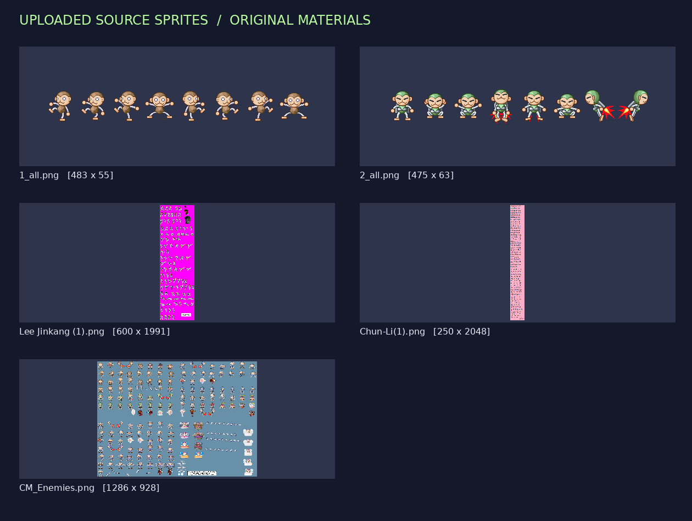
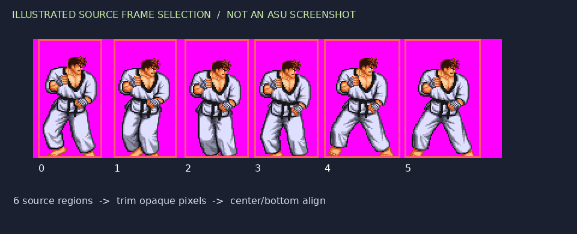
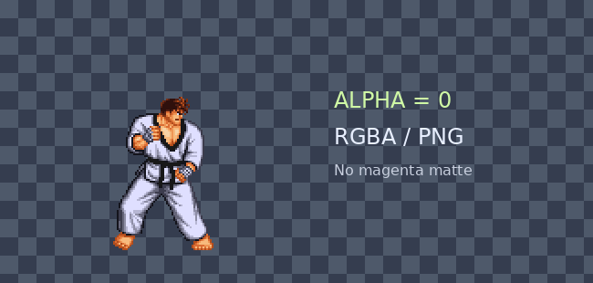
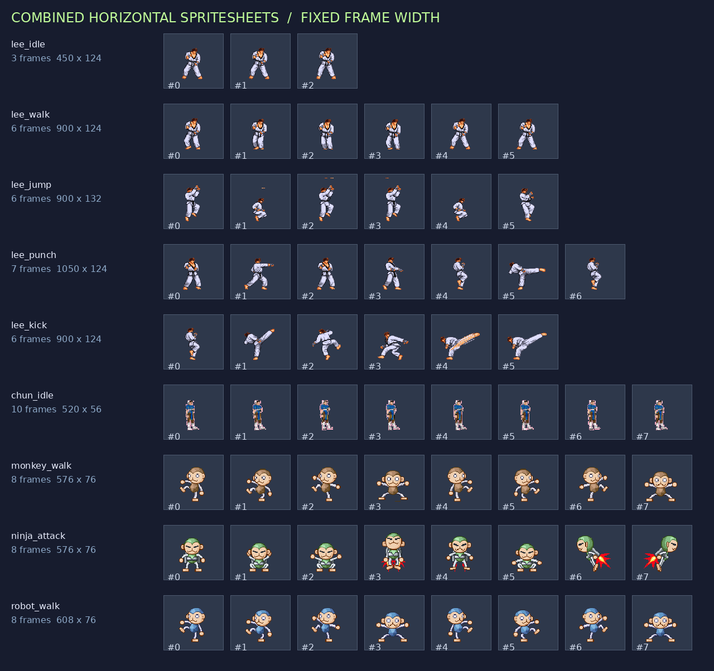
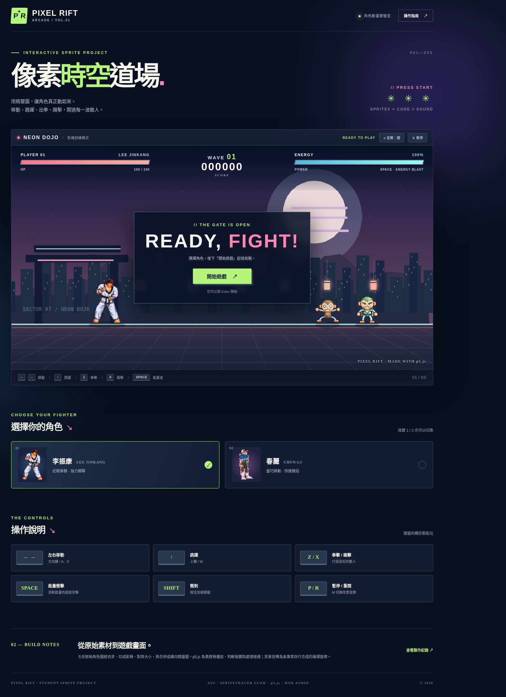
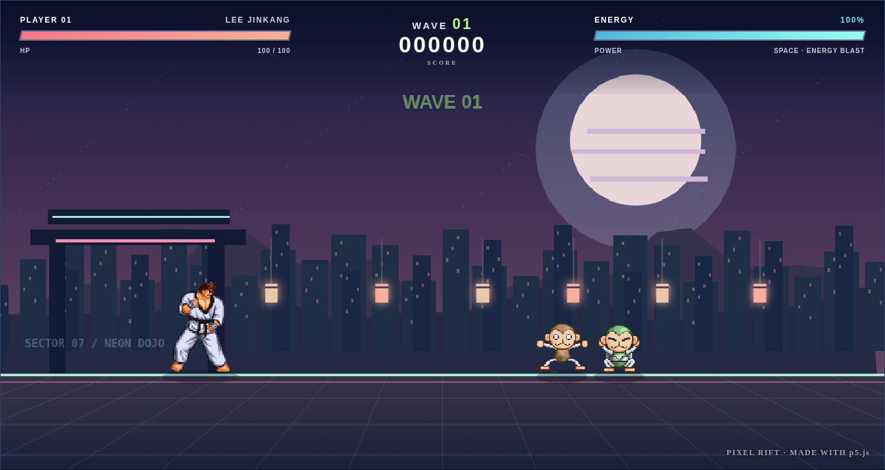
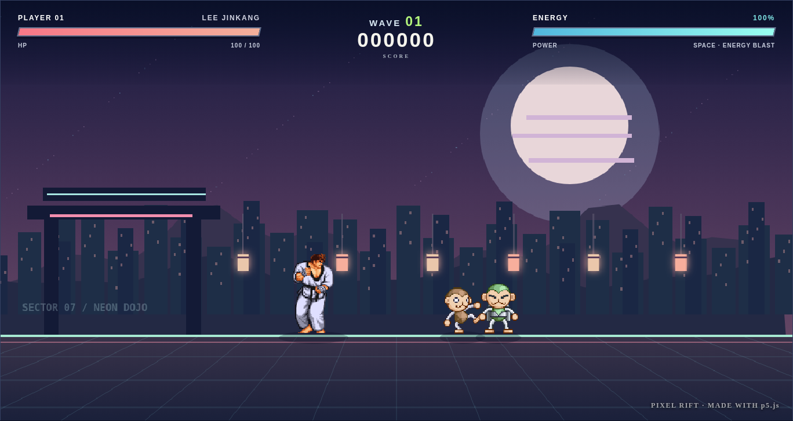
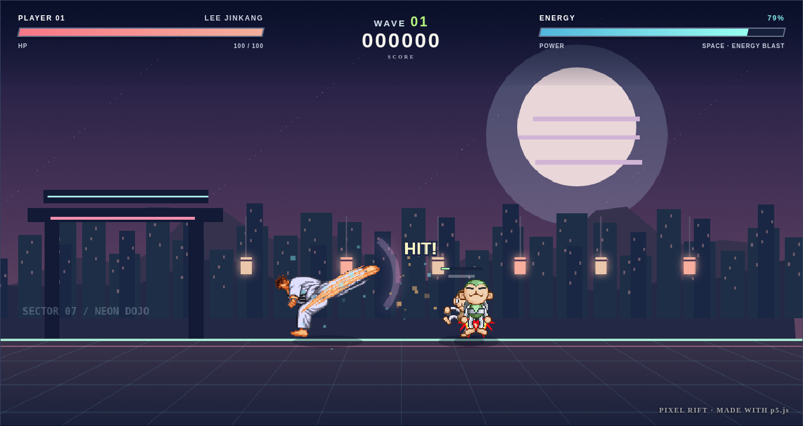

# 角色精靈圖前處理：ASU 切圖 ＋ SpriteTracer 合併 完整教材

> 整合來源：① 2025/11/25 課堂錄影的實際操作流程　② 你提供的 ASU 與 SpriteTracer 兩份說明文件。
> 課堂流程以**錄影實際操作**為準；兩份說明文件中課堂沒示範、或與課堂操作不同的功能，集中放在第 6 節「補充與差異」。

## 0. 這兩個工具在做什麼

| 工具 | 用途 | 輸入 → 輸出 |
|---|---|---|
| **ASU**（Alferd Spritesheet Unpacker） | 把一張「動作大圖」自動切成一格一格的小圖 | 1 張精靈圖集 → 0.png、1.png、2.png … |
| **SpriteTracer 6** | 把同一個動作的小圖**對齊大小後，合併成一張橫向長條圖** | 一組小圖 → 1 張長條圖（例：1955×212，14 張） |

整體流程：

```text
找一張有連續動作的角色圖
        ↓
ASU：自動切圖 → 依動作順序選取 → 匯出到「動作資料夾」
        ↓
SpriteTracer：設透明 → Balance 平衡 → Combine 合併 → 存檔
        ↓
得到「每個動作一張長條圖」＋ 記下 寬 × 高 × 張數
        ↓
下一步：把圖檔路徑、張數、寬高交給 AI 寫 p5.js 動畫
```

## 1. 先備：挑選素材

- 到 Sprite Database（spritedatabase.net）等網站搜尋角色，找**連續動作多**的圖：待機、走路、跑步、跳躍、發射武器、被打倒…
- 有「武器／功力發出去」特效的更適合做發功動畫。
- 圖要**夠大**；動作太少或圖太小不建議使用。
- 背景最好是**單一純色或透明**（ASU 靠背景色自動偵測）。

## 2. 下載與安全

1. **ASU**：iClass「相關檔案」下載 **ASU_19**（版本 19）；或到 Sprite Database 的 Utilities 下載。
2. **SpriteTracer 6**：iClass「相關檔案」最底下下載；或自 Sprite Database 取得。
3. 兩者都是**免安裝**，右鍵 → **解壓縮** 後直接執行 `.exe`。
4. 只從 iClass 或 Sprite Database 下載，**不要**從不明的第三方下載站取得。
5. 不放心可把 `.exe` 上傳 [VirusTotal](https://www.virustotal.com/) 掃描；防毒誤報時，確認安全後再加入信任清單。
6. ASU 開啟會播放 8-bit 背景音樂，是作者特意設計，不是病毒，可調低音量。
7. 若跳出「無法啟動」，通常是缺少 .NET Framework，需安裝對應版本。

## 3. ASU 操作步驟（切圖）

### 3-1 載入圖片
- 把圖片**直接拖進 ASU 視窗**（課堂做法）；或按 **From File** 選檔；或複製圖片後按 **From Clipboard** 貼上。

### 3-2 自動偵測
- ASU 會自動辨識背景，並用**紅框**標出每一個動作格。

### 3-3 手動微調
| 狀況 | 做法 |
|---|---|
| 兩個動作黏在一起 | 用 **Split（剪刀）** 切開 |
| 漏掉某一格 | 進入 **Cut Mode**，用滑鼠拉框新增 |
| 一個角色被切成好幾小塊 | 按住 **Ctrl** 點選那些紅框，再按 **Combine Selected** 合併 |
| 圖太大（如翻轉）無法切 | 可略過，不一定要用 |

### 3-4 依「動作順序」選取並匯出（重點）
以「停止 stop」（梳頭髮待機，共 14 張）為例：

1. **照動作順序**依序點選每一張（順序就是動畫播放順序，不要亂點）。
2. 在下載區先建好資料夾：

   ```text
   下載/20251125/        ← 今天日期
   └─ 1/                 ← 角色一
      ├─ stop/           ← 停止
      ├─ walk/           ← 走路
      ├─ run/            ← 跑步
      ├─ jump/           ← 跳起來
      ├─ push/           ← 發功（推出去）
      └─ to/             ← 發射出去的特效（名稱可自訂）
   ```
3. **複製資料夾路徑**，貼到視窗最下方的 **export location**。
4. 按 **Export Selected** 匯出（建議 PNG，保留透明）。資料夾會得到 `0.png、1.png …`（**編號從 0 開始**）。
5. 按 **De-select All（全部取消）**，再選下一個動作、改匯出路徑，重複。

> 為什麼不用 Export All？因為 Export All 會把整張圖所有格子混在一起；我們需要**一個動作一個資料夾**，且順序正確，所以用「依序選取 → Export Selected」。
> 每個角色先做 **2～3 個動作**即可。

## 4. SpriteTracer 6 操作步驟（合併成長條圖）

> 提醒：**不要把視窗放大**（課堂電腦放大後會一直發出聲音）。

每個動作都重複下列流程，**順序很重要：先設透明 → 再平衡 → 再合併 → 存檔**。

| 步驟 | 動作 | 說明 |
|---|---|---|
| 1 | **Settings → 設為透明** | 勾選 Transparent，不要用預設綠幕。開檔前設定一次即可 |
| 2 | **開啟檔案** | 到 `20251125/1/stop`，點第一張，按住 **Shift** 點最後一張，一次選取全部 |
| 3 | **Balance（平衡）** | 每張小圖寬高不同；按 Balance，以**中心（center）**為基準，OK 後每張大小相同（例：135×212） |
| 4 | **Combine（合併）** | 合併成一張橫向長條圖（0～13 排成一列） |
| 5 | **存檔** | 檔名要清楚：stop、walk、run、jump、push… |
| 6 | **清除** | 刪除全部，換下一個動作 |

## 5. 最重要的結果：記下「寬 × 高 × 張數」

- 只需要**合併後的那一張長條圖**，單張小圖只是中間產物。
- 滑鼠移到圖上可看到尺寸，例如 **1955 × 212**，共 **14 張**。
- 下一步請 AI 寫 p5.js 時，**一定要提供**：
  1. 圖檔路徑（如 `1/stop/stop.png`）
  2. 這是精靈圖，**共幾張**
  3. 整張圖的**寬、高**（程式用「寬 ÷ 張數」算出每一格寬度）

可直接套用的提問範例：

```text
你是專業的 p5.js 程式設計師。
角色一的待機動作圖檔為 1/stop/stop.png，是橫向精靈圖，共 14 張，
整張圖寬 1955、高 212。請用 p5.js 以 12 fps 循環播放這個動作。
```

## 6. 補充與差異（來自你提供的兩份說明文件）

以下為說明文件中提到、**課堂錄影未示範**或**與課堂操作不同**的內容，請依實際軟體畫面確認後再使用。

**ASU 補充**
- `From Clipboard`、`Cut Mode`、`Combine Selected`、`Export All` 在說明文件中有列出；課堂主要使用拖曳載入、Split、Export Selected。
- 匯出建議選 **PNG** 以保留透明；ASU 會盡量保留原始色盤（Indexed Color），很適合像素風、MUGEN 素材。
- 背景若不是單色或透明，自動偵測可能失敗。

**SpriteTracer 差異（請特別注意）**
- 說明文件把 SpriteTracer 描述成「Pick Background Color 吸管、Tolerance 容差、Trace/Process、Re-pack」的**去背擷取工具**。
- **課堂實際使用的 SpriteTracer 6 流程是 Settings 透明 → Balance → Combine → 存檔**，用途是「合併動作成長條圖」。
- 兩者功能描述不同，可能是版本差異或文件整理有誤；**教學以課堂流程為準**。若你的版本真的有 Tolerance、Minimum Sprite Size 等選項：
  - 邊緣被吃掉 → 降低 Tolerance。
  - 細節被切碎 → 調高 Minimum Sprite Size。

**替代工具**（課堂未使用）：Aseprite（像素繪圖＋動畫切圖）、Shoebox（螢幕截圖自動切片）、TexturePacker（遊戲引擎素材打包）。

## 7. 常見問題

| 問題 | 原因／解法 |
|---|---|
| 背景沒有去乾淨 | 原圖背景不是單色或透明；改找背景單純的圖 |
| 角色被切成碎塊 | 按住 Ctrl 多選紅框 → Combine Selected |
| 動畫播放順序亂掉 | 匯出前沒有依動作順序點選；重新選取並匯出 |
| 動畫抖動、跳位 | 合併前沒有 Balance，或基準不一致；重做平衡 |
| 合併圖背景是綠色 | 忘了先設 Transparent；清除後設定透明再合併 |
| 圖檔放哪都找不到 | 資料夾一個動作一個，檔名清楚，並記錄路徑 |
| 程式切格錯位 | 寬、高或張數記錯；用「寬 ÷ 張數」重新確認 |

## 8. 課堂檢查清單

- [ ] 找到一張有連續動作、背景單純的圖並下載
- [ ] ASU 能自動切圖，必要時用 Split／Cut Mode／Combine Selected 修正
- [ ] 依動作順序選取，匯出到 `日期/角色/動作` 資料夾（0.png 開始）
- [ ] SpriteTracer：透明 → Balance → Combine → 存檔，每個動作一張長條圖
- [ ] 記下每張長條圖的**寬 × 高 × 張數**
- [ ] 把路徑與數字交給 AI，請它寫 p5.js 動畫


---

# 附錄 A｜本次角色動畫作業實作結果（2026-11-05）

> **重要誠實註記：**本附錄是此次上傳素材的實際處理紀錄。ASU_19.zip 與 SpriteTracer6.zip 為 Windows `.exe` 程式，本次執行環境無法操作其 GUI，因此**沒有聲稱使用 ASU 的 Export Selected 或 SpriteTracer 的 Balance／Combine 按鈕**，也沒有偽造這兩套軟體的畫面。實作使用 Pillow 依相同原理「去背→分格→置中／腳底對齊→橫向合併」，由 `tools/prepare_sprites.py` 可重現。到 Windows 電腦操作後可補上真正的 GUI 截圖。

## A-1. 作品介紹

作品：**PIXEL RIFT｜像素時空道場**。以 `Lee Jinkang (1).png` 為主角一、`Chun-Li(1).png` 為主角二，`1_all.png`、`2_all.png`、`CM_Enemies.png` 為敵方角色；程式化產生的 `energy_blast.png` 是空白鍵施放的特效。使用 p5.js 精靈圖切格、原創 16 秒 WAV 循環配樂、鍵盤控制、碰撞與計分。



**素材來源：**由作業提出者在本次對話直接提供，原始下載網址及授權資訊未提供；公開網站前應確認素材可公開使用。

| 上傳素材 | 原圖寬 × 高 | 背景處理 |
|---|---:|---|
| `1_all.png` | 483 × 55 | 已透明，利用 alpha 分割 |
| `2_all.png` | 475 × 63 | 已透明，利用 alpha 分割 |
| `Chun-Li(1).png` | 250 × 2048 | 粉紅色 #FFAEC9 → 透明 |
| `CM_Enemies.png` | 1286 × 928 | 藍灰色 #6890A8 → 透明 |
| `Lee Jinkang (1).png` | 600 × 1991 | 純洋紅色 #FF00FF → 透明 |

## A-2. 與教材對照：ASU 切圖

- 教材的 **依序選取→匯出 0.png、1.png…**：本次由 `prepare_sprites.py` 依來源圖上的實際動作區塊，依序輸出 `1/stop/0.png`、`1/stop/1.png` 等。
- 教材的 **Split／Cut Mode**：本次沒有在 ASU 視窗手動操作；程式以來源座標指定每格範圍，避免相鄰影格混在一起。
- 教材的 **一個動作一個資料夾**：已建立 `1/stop`、`1/walk`、`1/run`、`1/jump`、`1/push`、`1/punch`、`1/to`；另外有 `2/`（春麗）、`3/`（猴）、`4/`（綠猴）、`5/`（藍猴）。`1/run` 目前沿用 `1/walk` 影格，**不是聲稱另外取得跑步原圖**。



## A-3. 與教材對照：SpriteTracer 合併

- **Settings→Transparent** 的等效結果：所有輸出 PNG 背景 alpha=0，沒有色底。
- **Balance→center** 的等效結果：每格置中、腳底對齊，使用固定畫格寬高。
- **Combine** 的等效結果：同一動作的小圖從左至右排列成長條圖。合併後存於 `assets/sheets/` 和課堂習慣的 `1/stop/stop.png` 等路徑。





## A-4. 最重要的結果：實際寬、高與張數

| 角色／動作 | p5.js 讀圖路徑 | 總寬 | 高 | 張數 | 單格寬 |
|---|---|---:|---:|---:|---:|
| monkey_walk | `assets/sheets/monkey_walk.png` | 576 | 76 | 8 | 72 |
| ninja_attack | `assets/sheets/ninja_attack.png` | 576 | 76 | 8 | 72 |
| lee_idle | `assets/sheets/lee_idle.png` | 450 | 124 | 3 | 150 |
| lee_walk | `assets/sheets/lee_walk.png` | 900 | 124 | 6 | 150 |
| lee_jump | `assets/sheets/lee_jump.png` | 900 | 132 | 6 | 150 |
| lee_punch | `assets/sheets/lee_punch.png` | 1050 | 124 | 7 | 150 |
| lee_kick | `assets/sheets/lee_kick.png` | 900 | 124 | 6 | 150 |
| lee_hurt | `assets/sheets/lee_hurt.png` | 300 | 124 | 2 | 150 |
| chun_idle | `assets/sheets/chun_idle.png` | 520 | 56 | 10 | 52 |
| chun_walk | `assets/sheets/chun_walk.png` | 416 | 56 | 8 | 52 |
| chun_jump | `assets/sheets/chun_jump.png` | 312 | 56 | 6 | 52 |
| chun_punch | `assets/sheets/chun_punch.png` | 312 | 56 | 6 | 52 |
| chun_kick | `assets/sheets/chun_kick.png` | 312 | 56 | 6 | 52 |
| chun_hurt | `assets/sheets/chun_hurt.png` | 104 | 56 | 2 | 52 |
| robot_walk | `assets/sheets/robot_walk.png` | 608 | 76 | 8 | 76 |
| robot_idle | `assets/sheets/robot_idle.png` | 608 | 76 | 8 | 76 |
| energy_blast | `assets/sheets/energy_blast.png` | 384 | 64 | 6 | 64 |

全部長條圖符合 `總寬 = 單格寬 × 張數`，且單格寬均為整數。程式使用 `image(img, dx, dy, dw, dh, index*frameWidth, 0, frameWidth, frameHeight)` 擷取影格；詳細設定請見 `assets/sprite-data.json`。

## A-5. 程式與測試摘要

- 檔案：`index.html`、`style.css`、`sketch.js`，圖片及聲音在 `assets/`。
- 功能：左右移動、跳躍、Z 拳擊、X 踢擊、空白鍵遠距離特效、Shift 衝刺、1/2 切換主角、P 暫停、R 重來、M 音樂開關、敵人生命值與波次計分。
- 配樂：`assets/audio/dojo-loop.wav`（本專案以程式合成之原創旋律）；瀏覽器要求使用者點擊後才播放。
- 在隔離式 Chromium 測試環境使用 **相同 sketch.js 及真實圖片素材、以本地相容渲染器替代無法連線的外部 p5.js CDN** 進行操作測試；啟動、移動、攻擊、換角、暫停均通過，未發現 JavaScript 執行錯誤。**線上正式 p5.js CDN 版本及 GitHub Pages 尚未部署測試。**







## A-6. 尚需自行完成或確認的事項

1. 依學校要求，在 Windows 電腦實際打開 ASU 與 SpriteTracer，補上工具內的切圖紅框、透明設定、Balance 前後等**真實操作畫面**；目前文件使用的是明確標示的演算法示意與實際輸出圖，不能取代 GUI 操作證明。
2. 補上姓名、學號、素材原始網址及授權資訊；由使用者確認 Windows 的 VS Code 安裝情形。
3. 使用自己的 GitHub 帳號建立 Repository、上傳本專案並在 Settings → Pages 啟用 `main / (root)`，才能得到**真實可開啟的** GitHub 與 GitHub Pages 網址；本附錄沒有預先填入虛構連結。
