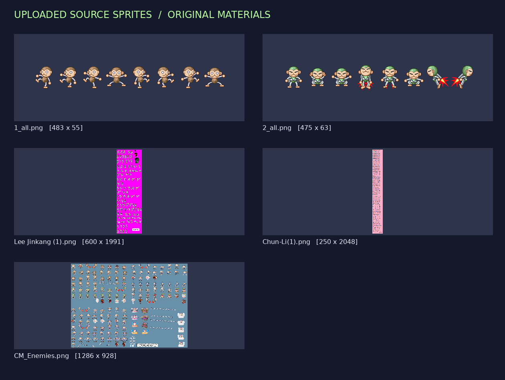
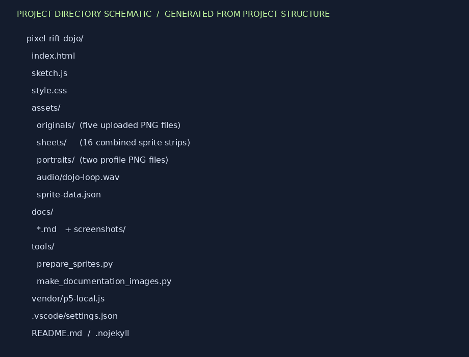
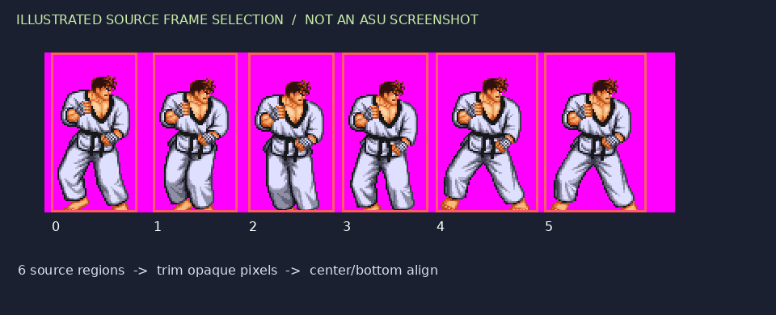
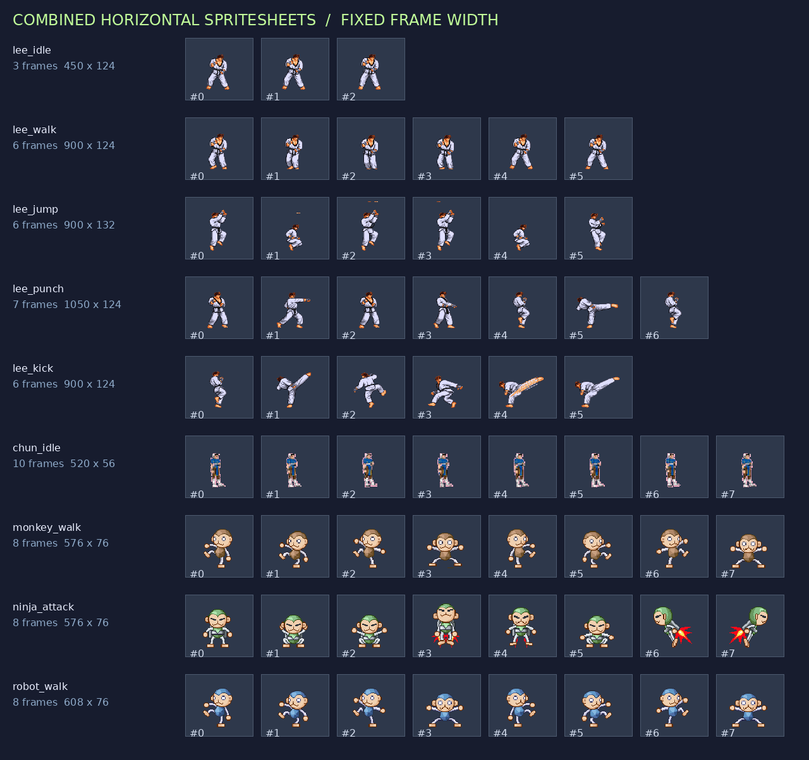
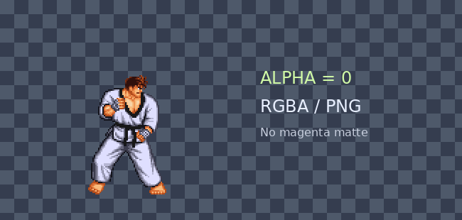
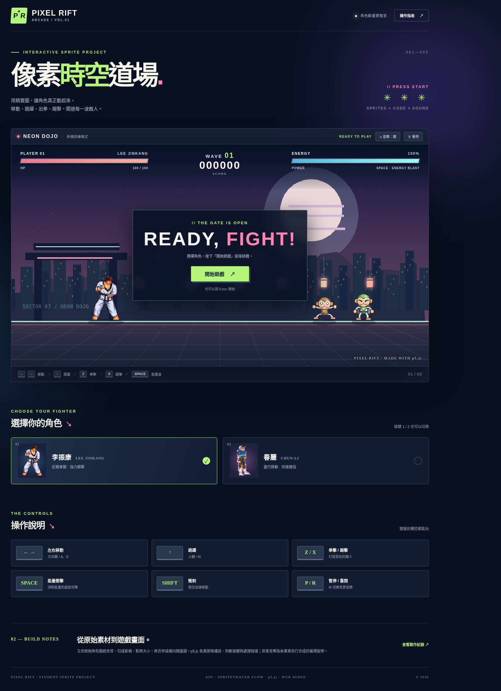
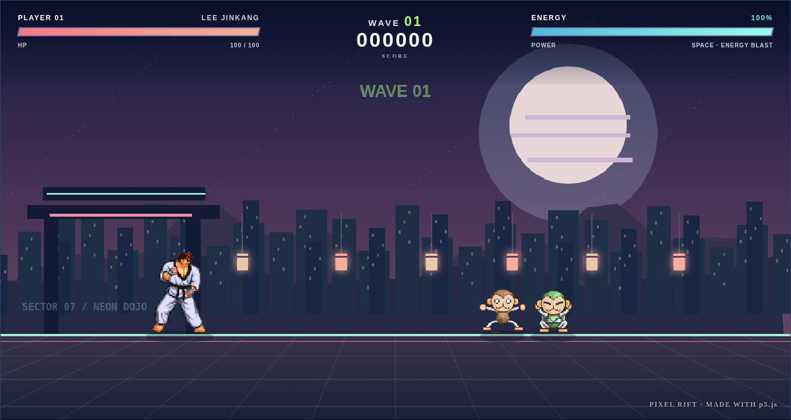
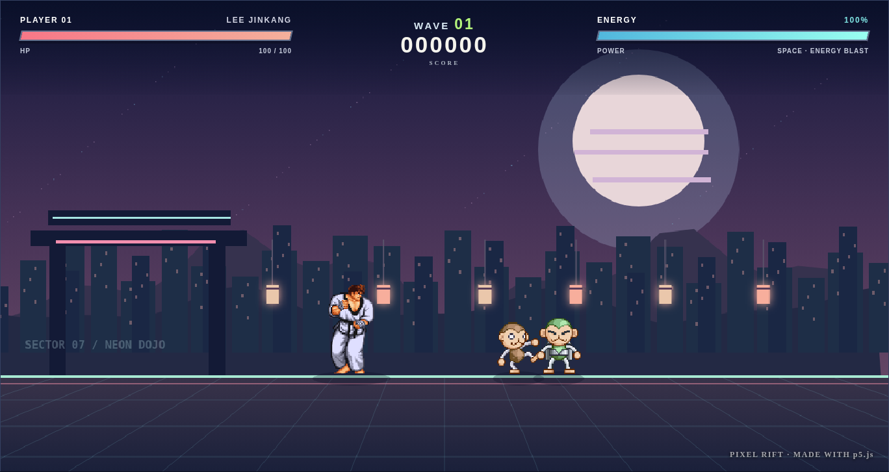
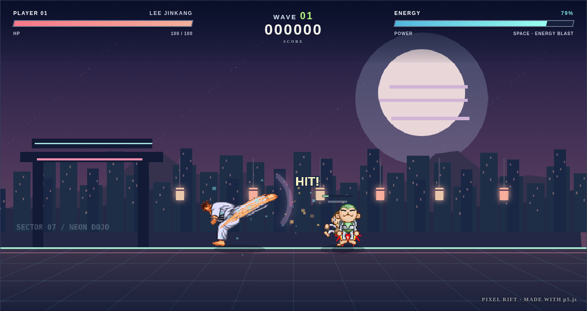
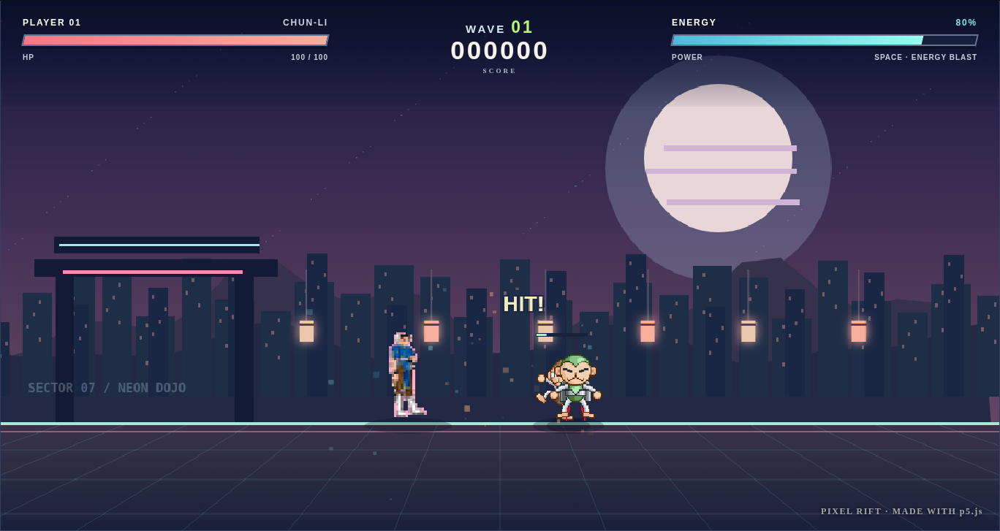

# 角色動畫製作紀錄（學生版・已依實際製作填寫）

> 對應課堂五部影片：找精靈圖 → ASU 切圖 → SpriteTracer 合併 → AI／VS Code 製作 p5.js 動畫 → 加入音樂。

> **資料真實性說明：**以下填入已製作及已驗證的內容；若為來源不明、姓名學號、Windows 工具 GUI 截圖、GitHub 真實公開網址，保留「待補／待確認」，不虛構。此次使用 Python／Pillow 依教材原理完成切圖，**不是在 Windows ASU／SpriteTracer 視窗點擊完成**。

---

## 0. 基本資料

| 項目 | 填寫 |
|---|---|
| 姓名 | **待本人填寫**（未提供） |
| 學號 | **待本人填寫**（未提供） |
| 日期 | 2026-11-05 |
| 我的角色名稱／來源網站 | 李振康（Lee Jinkang）、春麗（Chun-Li）、褐猴／綠猴／藍猴敵人；五張素材均由本人提供，原始下載網址**待補** |
| 使用的 AI 工具 | ChatGPT（GPT-6）；未宣稱使用 Gemini／Copilot |
| GitHub Repository 網址 | **尚未建立／待本人授權發布後填寫** |
| GitHub Pages 網址 | **尚未發布／待本人授權發布後填寫** |
| 專案名稱 | **PIXEL RIFT｜像素時空道場** |

## 1. 我選的精靈圖



**為什麼選這些角色？** 李振康有待機、移動、跳躍、拳擊與踢擊的連續影格，可作為主角；春麗可做第二位可切換角色；褐猴、綠猴及藍猴有連續動作，適合作為對戰敵人，能在同一個網站呈現多角色互動。

| 原始素材 | 原圖尺寸 | 圖片來源 |
|---|---|---|
| `1_all.png` | 483 × 55 | 由使用者於本對話上傳（原始網址未提供） |
| `2_all.png` | 475 × 63 | 由使用者於本對話上傳（原始網址未提供） |
| `Chun-Li(1).png` | 250 × 2048 | 由使用者於本對話上傳（原始網址未提供） |
| `CM_Enemies.png` | 1286 × 928 | 由使用者於本對話上傳（原始網址未提供） |
| `Lee Jinkang (1).png` | 600 × 1991 | 由使用者於本對話上傳（原始網址未提供） |

**來源說明：**這些圖像是本次作業提供的檔案，未提供來源網站 URL，無法負責任地填成某一個網址。部分原圖右下角或圖面內有來源文字，公開網站前仍應另行確認原作者與授權。

## 2. ASU 切圖紀錄

### 2-1 資料夾結構

依課堂概念建立角色／動作資料夾；`0.png`、`1.png` 代表每個動作的連續格，`stop.png` 等代表合併長條圖。

```text
pixel-rift-dojo/
├─ 1/                        李振康
│  ├─ stop/   0.png 1.png 2.png stop.png
│  ├─ walk/   0.png ... 5.png walk.png
│  ├─ run/    與 walk 共用相同來源影格（不是新跑步原圖）
│  ├─ jump/   0.png ... 5.png jump.png
│  ├─ punch/  0.png ... 6.png punch.png
│  ├─ push/   0.png ... 5.png push.png
│  └─ to/     0.png ... 5.png to.png（原創能量波）
├─ 2/                        春麗：stop / walk / jump / punch / push
├─ 3/walk/                   褐猴（8 格）
├─ 4/push/                   綠猴（8 格）
├─ 5/stop/、5/walk/           藍猴（各 8 格）
├─ assets/originals/         五張原圖
├─ assets/sheets/            網頁使用的 17 張長條圖
└─ assets/sprite-data.json   實際尺寸及影格數
```



### 2-2 ASU 畫面／切圖方法

**實際執行情形：**有提供 `ASU_19.zip`，但此次環境無法執行 Windows GUI，故沒有 ASU 自動紅框、Split 按鈕或 Export Selected 的真實截圖。本次以 `tools/prepare_sprites.py` 讀取原圖、辨識透明／純色背景、按照來源動作座標選取各格、依序輸出每個動作的 `0.png ... n.png`。

**Split（剪刀）有沒有使用？** 沒有在 ASU 操作。改用程式手動設定分割範圍，特別處理 `Lee Jinkang (1).png` 的不等寬格子及小圖與大圖混排情況；避免人物左右相黏。



> 若老師要求 ASU 工具視窗截圖：**待在 Windows 真的操作後補上**，目前這張只是依源圖畫出的切割示意。

### 2-3 每個動作切了幾張

| 角色／動作 | 資料夾 | 張數 | 順序 |
|---|---|---:|---|
| 李振康 stop | `1/stop/` | 3 | ✓ 由左至右 |
| 李振康 walk | `1/walk/` | 6 | ✓ 由左至右 |
| 李振康 run | `1/run/` | 6 | ✓ 沿用 walk，非獨立跑步素材 |
| 李振康 jump | `1/jump/` | 6 | ✓ 由左至右 |
| 李振康 punch | `1/punch/` | 7 | ✓ 由左至右 |
| 李振康 push／踢擊 | `1/push/` | 6 | ✓ 由左至右 |
| 能量特效 to | `1/to/` | 6 | ✓ 程式原創特效 |
| 春麗 stop／walk／jump／punch／push | `2/` 各動作資料夾 | 10／8／6／6／6 | ✓ 依來源圖片排序 |
| 褐猴／綠猴／藍猴 | `3/`、`4/`、`5/` | 8／8／8 | ✓ 依來源圖片排序 |



## 3. SpriteTracer 合併紀錄

> 教材要求 **Transparent → Open → Balance → Combine → Save**；本次以 Pillow 做出等效產物，不冒充 SpriteTracer UI 操作。

### 3-1 每個動作的合併過程

**設定透明：** `1_all.png` 和 `2_all.png` 原本已是 RGBA 透明；李振康 `#FF00FF`、春麗 `#FFAEC9`、敵人圖 `#6890A8` 的純色背景設為 Alpha=0。結果下方以棋盤背景展示透明效果，**不是 Settings 勾選 Transparent 的截圖**。



**Balance 前：**源圖不同動作人物大小不一致、每格寬度不等；實作讀取每格非透明範圍。**Balance 後：**自動裁出非透明外接矩形後，將其置中、腳底對齊到指定的固定畫格。最後水平 Combine 合成長條圖。下圖顯示真實輸出結果。


**各動作對照：** `stop` → `lee_idle.png`；`walk` → `lee_walk.png`；`jump` → `lee_jump.png`；`push` → `lee_kick.png`；`to` → `energy_blast.png`。中途的小圖保留在 `1/`～`5/` 各動作資料夾。

### 3-2 ⭐ 合併後的實際尺寸表

**下表的路徑全部以 `sketch.js` 所在根目錄為基準，且數字由 PNG 實測取得，不是老師範例數字。**

| 動作 | 圖檔路徑 | 總寬 | 高 | 張數 | 單格寬（總寬 ÷ 張數） |
|---|---|---:|---:|---:|---:|
| monkey_walk | `assets/sheets/monkey_walk.png` | 576 | 76 | 8 | 72 |
| ninja_attack | `assets/sheets/ninja_attack.png` | 576 | 76 | 8 | 72 |
| lee_idle | `assets/sheets/lee_idle.png` | 450 | 124 | 3 | 150 |
| lee_walk | `assets/sheets/lee_walk.png` | 900 | 124 | 6 | 150 |
| lee_jump | `assets/sheets/lee_jump.png` | 900 | 132 | 6 | 150 |
| lee_punch | `assets/sheets/lee_punch.png` | 1050 | 124 | 7 | 150 |
| lee_kick | `assets/sheets/lee_kick.png` | 900 | 124 | 6 | 150 |
| lee_hurt | `assets/sheets/lee_hurt.png` | 300 | 124 | 2 | 150 |
| chun_idle | `assets/sheets/chun_idle.png` | 520 | 56 | 10 | 52 |
| chun_walk | `assets/sheets/chun_walk.png` | 416 | 56 | 8 | 52 |
| chun_jump | `assets/sheets/chun_jump.png` | 312 | 56 | 6 | 52 |
| chun_punch | `assets/sheets/chun_punch.png` | 312 | 56 | 6 | 52 |
| chun_kick | `assets/sheets/chun_kick.png` | 312 | 56 | 6 | 52 |
| chun_hurt | `assets/sheets/chun_hurt.png` | 104 | 56 | 2 | 52 |
| robot_walk | `assets/sheets/robot_walk.png` | 608 | 76 | 8 | 76 |
| robot_idle | `assets/sheets/robot_idle.png` | 608 | 76 | 8 | 76 |
| energy_blast | `assets/sheets/energy_blast.png` | 384 | 64 | 6 | 64 |

檢查結果：**全部單格寬均為整數**。`assets/sprite-data.json` 保存以上完整機器可讀資料。

## 4. 與 AI 對話紀錄

> **說明：**本次是以使用者「依照五部教材與上傳素材製作成果、填寫兩份 MD、提供 VS Code 專案和 GitHub 網站」的指示開始協作。下面「指令」整理為本次程式的**實際開發規格**，並非假稱使用者逐字輸入過每個範例提問。程式碼引用為此次產出的 `sketch.js`。

### 4-1 開發環境

| 項目 | 狀況 |
|---|---|
| VS Code 中文介面 | 由使用者的 Windows 電腦自行確認；本端無法查驗 |
| p5.js 擴充套件 | 由使用者自行確認（網站直接引用官方 p5.js 1.9.0 CDN） |
| Gemini／Copilot 登入 | 未使用；本次是與 ChatGPT 協作 |
| 專案資料夾 | `pixel-rift-dojo`，附 `.vscode/settings.json` |
| 檔案預覽 | 已在隔離式 Chromium 用同一份程式和實際圖像進行互動測試；因外部 CDN 無法存取，測試時使用本地相容渲染器 |

### 4-2 指令①：全視窗畫布與背景色

**開發規格：**「建立可在 VS Code Live Server 與 GitHub Pages 使用的 p5.js 單頁網頁，畫布固定 1280×680 並以 CSS 自適應縮放；背景為霓虹夜景，含山、城市、月亮、地板與 HUD。」

**結果：**首頁及遊戲背景已完成；利用 CSS 讓畫布隨容器寬度縮放，仍保留 p5.js 的固定設計座標。



```javascript
const WORLD = { width: 1280, height: 680, floor: 543, gravity: 0.86 };
function setup() {
  const canvas = createCanvas(WORLD.width, WORLD.height);
  canvas.parent('canvas-holder');
  pixelDensity(1); noSmooth();
  // 其餘初始化詳見下方完整 sketch.js
}
function draw() {
  backgroundScene();
  drawObjects();
  paintHUD();
}
```

### 4-3 指令②：中間產生角色（stop 動畫）

**開發規格：**「從 `assets/sheets/lee_idle.png` 載入橫向精靈圖，共 **3 張**、**總寬 450、高 124**；以單格寬 150 擷取，主角起始 x=290，站在地面 y=543，沒有按鍵時循環播放待機。」

**結果：**李振康可站立待機，主角圖像使用透明背景且角色不會被切到另一格。



```javascript
const m = META['lee_idle']; // frameWidth=150, frameHeight=124, frames=3
const frameIndex = Math.floor(ambientTime / 11) % m.frames;
image(sheets['lee_idle'], -m.frameWidth/2, -m.frameHeight,
      m.frameWidth, m.frameHeight, frameIndex*m.frameWidth, 0,
      m.frameWidth, m.frameHeight);
```

### 4-4 指令③：往右鍵／往左鍵（走路、轉向）

**開發規格：**「按左右方向鍵（或 A/D）移動，切換 `lee_walk.png` 六格動畫；往左時以 `scale(-1,1)` 水平翻轉，放開回到 stop。」

**結果：**角色可左右移動，方向朝向與按鍵相同，放開能回到待機。Shift 能衝刺。



```javascript
const dir = (keys.ArrowRight || keys.KeyD ? 1 : 0) -
            (keys.ArrowLeft || keys.KeyA ? 1 : 0);
if (dir) { hero.x += dir * FIGHTERS[fighter].speed * dt; hero.face = dir; }
// draw 時：translate(hero.x, hero.y); scale(scaleFactor*hero.face, scaleFactor);
```

### 4-5 指令④：往上鍵（跳起來）

**開發規格：**「使用 `lee_jump.png`（6 格、總寬 900、高 132），按 ↑/W 跳躍，加入重力與落地判定，避免重複無限跳躍。」

**結果：**`hero.vy=-17.1`，每幀增加重力 `0.86`；當 y 達地板 543 時重設速度、恢復地面狀態，不會穿過地板。

```javascript
function jump() {
  if (state !== 'playing' || !hero.grounded) return;
  hero.vy = -FIGHTERS[fighter].jump;
  hero.grounded = false;
  hero.action = 'jump';
}
// updateGame: hero.y += hero.vy*dt; hero.vy += WORLD.gravity*dt;
// if(hero.y >= WORLD.floor) { hero.y=WORLD.floor; hero.vy=0; hero.grounded=true; }
```

### 4-6 指令⑤：空白鍵（發功＋特效）

**開發規格：**「空白鍵使用 22 能量，施放左右方向的發光能量波；波會向角色面向方向移動，命中敵人扣血並出現擊中特效，另外支援 Z 拳擊、X 踢擊。」

**結果：**能量會減少，空白鍵產生遠距離投射物，命中敵人後顯示 HIT 與粒子；Z/X 可近身攻擊。



```javascript
if (hero.energy >= 22) {
  hero.energy -= 22;
  bolts.push({x:hero.x+hero.face*61, y:hero.y-87,
              vx:hero.face*12.5,life:85,hitIds:new Set()});
}
// updateGame 中 b.x += b.vx*dt；與敵人距離小於門檻時 damageEnemy(...)
```

### 4-7 進階：第二位角色與敵人互動

| 項目 | 成果 |
|---|---|
| 角色二素材 | `Chun-Li(1).png`，從 `2/` 讀取春麗動畫 |
| 角色二動作 | stop 10 格；walk 8 格；jump／punch／kick 各 6 格；hurt 2 格 |
| 第三位角色／敵方 | 褐猴、綠猴（各 8 格）；另有 CM 的藍猴 8 格 |
| 角色二是否放大 | 春麗依原始小圖放大約 3.03 倍；李振康約 1.56 倍 |
| 靠近互動 | 怪物靠近主角會攻擊；玩家可以拳、腳或能量波打退敵人 |
| 文字對話框／倒下 | 使用 HIT／K.O.／COMBO 浮字與敵人淡出；未製作口語對話框或完整倒地影格，沒有聲稱已完成 |



### 4-8 其他指令：配樂與介面

**開發規格：**「依第 5 部影片增加背景音樂和音效，避免自動播放被瀏覽器阻擋；加入開始畫面、暫停、重新挑戰、計分及手機可用的按鈕。」

**結果：**自製 `assets/audio/dojo-loop.wav`（16 秒可循環），按「♫ 音樂」或 M 開關；拳擊、踢擊、跳躍、命中、遊戲結束的音效以 Web Audio 合成。聲音需使用者點擊才能播放。畫面含開始、角色選擇、操作說明、血量／能量條與波次分數。

## 5. 遇到的問題與解決

| # | 問題（實際發現或測試訊息） | 解法 | 是否用 AI 協作 |
|---|---|---|---|
| 1 | 角色原圖背景有洋紅、粉紅、藍灰三色，直接使用會保留大色塊。 | 依原圖背景鍵色轉 RGBA 透明，並保留五份原始檔方便重做。 | 是，產生 `tools/prepare_sprites.py` |
| 2 | 大圖多個動作混排、寬高不一，等寬切圖會切到隔壁人物。 | 依來源動作區塊逐格裁切，再對齊固定格尺寸並水平合併。 | 是，先檢查尺寸並人工確認分格配置 |
| 3 | 測試程式出現 `drawCombatFX is not defined` 的 JavaScript 執行錯誤。 | 移除重複、無定義的呼叫，粒子與攻擊軌跡在 `drawAttackTrails()` 正常繪製；之後測試無執行錯誤。 | 是，修正 `sketch.js` |
| 4 | 測試用瀏覽器的外部網頁與 p5.js CDN 連線受到隔離限制。 | 保留**正式官方 p5.js CDN 優先**，加入 `vendor/p5-local.js` 作為本作品限定的離線相容備援；用同份 sketch.js、實際 PNG 測試互動。 | 是，增加離線測試機制 |
| 5 | 瀏覽器限制未互動前播放聲音。 | 需點擊音樂按鈕或按 M 才開始播放 WAV。 | 是，加入音樂開關與例外處理 |

**Console 實際測試情形：**最終隔離式 Chromium 測試顯示開始遊戲、移動、空白鍵攻擊、切換角色、暫停與繼續均可執行，無 JavaScript 執行錯誤。由於隔離工具無法訪問外部 CDN，尚需於真實 GitHub Pages 上測試官方 p5.js 正式版本。

**被我 Reject 的修改：**此次沒有真實的「拒絕 AI 建議」操作紀錄，故不虛構拒絕歷程；但已明確拒絕以自製示意圖冒充 ASU／SpriteTracer 軟體畫面。

## 6. 最終成果

### 6-1 完整程式碼（sketch.js）

以下是作品根目錄 `sketch.js` 的完整程式碼。HTML／CSS、音樂及圖片也同時包含在 ZIP 專案內。

```javascript
/* PIXEL RIFT — p5.js / JavaScript arcade.
   Original image files and reproducible image-cutting script are included.
   Combined sheets: crop frame index * frameWidth, width=frameWidth.
   Controls: arrows/A-D move, up/W jump, Z punch, X kick, Space energy,
             Shift sprint, 1/2 switch fighter, P pause, R restart, M music. */
const WORLD = { width: 1280, height: 680, floor: 543, gravity: 0.86 };
const META = {"monkey_walk":{"source":"1_all.png","frameWidth":72,"frameHeight":76,"frames":8,"width":576,"height":76},"ninja_attack":{"source":"2_all.png","frameWidth":72,"frameHeight":76,"frames":8,"width":576,"height":76},"lee_idle":{"source":"Lee Jinkang (1).png","frameWidth":150,"frameHeight":124,"frames":3,"width":450,"height":124},"lee_walk":{"source":"Lee Jinkang (1).png","frameWidth":150,"frameHeight":124,"frames":6,"width":900,"height":124},"lee_jump":{"source":"Lee Jinkang (1).png","frameWidth":150,"frameHeight":132,"frames":6,"width":900,"height":132},"lee_punch":{"source":"Lee Jinkang (1).png","frameWidth":150,"frameHeight":124,"frames":7,"width":1050,"height":124},"lee_kick":{"source":"Lee Jinkang (1).png","frameWidth":150,"frameHeight":124,"frames":6,"width":900,"height":124},"lee_hurt":{"source":"Lee Jinkang (1).png","frameWidth":150,"frameHeight":124,"frames":2,"width":300,"height":124},"chun_idle":{"source":"Chun-Li(1).png","frameWidth":52,"frameHeight":56,"frames":10,"width":520,"height":56},"chun_walk":{"source":"Chun-Li(1).png","frameWidth":52,"frameHeight":56,"frames":8,"width":416,"height":56},"chun_jump":{"source":"Chun-Li(1).png","frameWidth":52,"frameHeight":56,"frames":6,"width":312,"height":56},"chun_punch":{"source":"Chun-Li(1).png","frameWidth":52,"frameHeight":56,"frames":6,"width":312,"height":56},"chun_kick":{"source":"Chun-Li(1).png","frameWidth":52,"frameHeight":56,"frames":6,"width":312,"height":56},"chun_hurt":{"source":"Chun-Li(1).png","frameWidth":52,"frameHeight":56,"frames":2,"width":104,"height":56},"robot_walk":{"source":"CM_Enemies.png","frameWidth":76,"frameHeight":76,"frames":8,"width":608,"height":76},"robot_idle":{"source":"CM_Enemies.png","frameWidth":76,"frameHeight":76,"frames":8,"width":608,"height":76},"energy_blast":{"source":"原創程式繪製特效","frameWidth":64,"frameHeight":64,"frames":6,"width":384,"height":64}};
const SHEET_NAMES = Object.keys(META);
const FIGHTERS = {
  lee: { name: 'LEE JINKANG', label: '李振康', prefix:'lee', scale:1.56, speed:5.4, jump:17.1, damage:1.08 },
  chun:{ name: 'CHUN-LI',label:'春麗', prefix:'chun',scale:3.03,speed:6.1,jump:18.2,damage:.92 }
};
const ENEMY_KIND = {
  monkey: {strip:'monkey_walk',scale:1.43,health:3,speed:1.55,points:100,hue:'#fabe76'},
  ninja:  {strip:'ninja_attack',scale:1.50,health:3,speed:2.12,points:140,hue:'#aff287'},
  robot:  {strip:'robot_walk',scale:1.48,health:4,speed:1.4,points:180,hue:'#8bdcfd'}
};
let sheets={}, state='ready', fighter='lee', hero, enemies=[], bolts=[], particles=[], texts=[], score=0,wave=1, clock=0,ambientTime=0,shake=0,combo=0,comboClock=0,keys={},soundEnabled=false,bgm=null,audioCtx=null,enemySerial=0;
let canvasReady=false, currentMessage='ready';

function preload(){
  for(const name of SHEET_NAMES){ sheets[name]=loadImage('assets/sheets/'+name+'.png'); }
}
function setup(){
  const canvas=createCanvas(WORLD.width,WORLD.height);
  canvas.parent('canvas-holder');
  pixelDensity(1);
  noSmooth();
  hero=makeHero();
  enemies=[makeEnemy('monkey',960),makeEnemy('ninja',1080)];
  bgm=new Audio('assets/audio/dojo-loop.wav'); bgm.loop=true; bgm.volume=.32;
  bindUI();
  canvasReady=true;
  document.getElementById('loadingMessage').classList.add('hidden');
  paintHUD();
}
function makeHero(){return {x:290,y:WORLD.floor,vy:0,face:1,health:100,energy:100,grounded:true,action:'idle',actionAge:0,actionLen:0,invuln:0,speedF:0};}
function makeEnemy(type,x){const k=ENEMY_KIND[type];return {id:enemySerial++,type,x,y:WORLD.floor,hp:k.health,maxHp:k.health,face:-1,anim:Math.random()*30,hitAge:0,attackCD:80+Math.random()*90,dead:false,deathAge:0};}
function beginGame(){
  state='playing';hero=makeHero();score=0;wave=1;clock=0;combo=0;comboClock=0;enemySerial=0;enemies=[];bolts=[];particles=[];texts=[];
  spawnWave();hideMessage();updateStatus();beep('start');
}
function spawnWave(){
  const kinds=['monkey','ninja','robot'];
  const count=Math.min(2+Math.floor(wave/2),5);
  for(let i=0;i<count;i++){
    const type=kinds[(wave+i-1)%3];
    enemies.push(makeEnemy(type,900+i*115+Math.random()*45));
  }
  popText(WORLD.width/2,205,'WAVE '+String(wave).padStart(2,'0'),'#b9fc8b',75);
}
function draw(){
  const dt=Math.min(2.1,Math.max(.35,(typeof deltaTime==='number'?deltaTime:16.7)/16.67));
  ambientTime+=dt;
  if(state==='playing'){updateGame(dt);} 
  backgroundScene();
  drawObjects();
  paintHUD();
}
function updateGame(dt){
  clock+=dt;
  const c=FIGHTERS[fighter],left=keys.ArrowLeft||keys.KeyA||keys.btnLeft,right=keys.ArrowRight||keys.KeyD||keys.btnRight;
  const dir=(right?1:0)-(left?1:0);
  const sprint=(keys.ShiftLeft||keys.ShiftRight)?1.45:1;
  if(dir){hero.x+=dir*c.speed*dt*sprint;hero.face=dir;}
  hero.x=Math.max(68,Math.min(WORLD.width-65,hero.x));
  hero.y+=hero.vy*dt;hero.vy+=WORLD.gravity*dt;
  if(hero.y>=WORLD.floor){hero.y=WORLD.floor;hero.vy=0;hero.grounded=true;}
  hero.actionAge+=dt;
  if(hero.actionLen>0 && hero.actionAge>=hero.actionLen){hero.actionLen=0;hero.actionAge=0;}
  if(hero.actionLen<=0){hero.action=hero.grounded?(dir?'walk':'idle'):'jump';}
  hero.energy=Math.min(100,hero.energy+.078*dt);
  if(hero.invuln>0)hero.invuln-=dt;
  if(comboClock>0)comboClock-=dt;else combo=0;
  for(const enemy of enemies){
    enemy.anim+=dt;enemy.attackCD-=dt;
    if(enemy.dead){enemy.deathAge+=dt;continue;}
    const k=ENEMY_KIND[enemy.type];
    const distance=hero.x-enemy.x;
    enemy.face=Math.sign(distance)||-1;
    if(Math.abs(distance)>79){enemy.x+=Math.sign(distance)*k.speed*(1+.085*(wave-1))*dt;}
    if(Math.abs(distance)<85 && enemy.attackCD<=0 && hero.invuln<=0){
      hero.health=Math.max(0,hero.health-(enemy.type==='robot'?12:9));
      hero.invuln=46;hero.x=Math.max(70,Math.min(WORLD.width-70,hero.x-Math.sign(distance)*24));
      particlesAt(hero.x,hero.y-75,'#ffc0d2',15,4.5);
      popText(hero.x,hero.y-157,'-'+(enemy.type==='robot'?12:9),'#ff9eb9',48);
      enemy.attackCD=105;shake=8;beep('hurt');
    }
  }
  for(const b of bolts){
    b.x+=b.vx*dt;b.life-=dt;
    for(const e of enemies){if(e.dead||b.hitIds.has(e.id))continue;
      if(Math.abs(e.x-b.x)<65 && Math.abs((e.y-72)-b.y)<72){
        b.hitIds.add(e.id);damageEnemy(e,2.4,b.x,b.y);b.life=0;break;
      }
    }
  }
  bolts=bolts.filter(b=>b.life>0 && b.x>-40 && b.x<1320);
  enemies=enemies.filter(e=>!e.dead || e.deathAge<27);
  for(const p of particles){p.x+=p.vx*dt;p.y+=p.vy*dt;p.vy+=.11*dt;p.life-=dt;}
  particles=particles.filter(p=>p.life>0);
  for(const t of texts){t.y-=.73*dt;t.life-=dt;}
  texts=texts.filter(t=>t.life>0);
  if(shake>0)shake-=dt;
  if(enemies.length===0 && clock>100){wave++;clock=0;hero.energy=Math.min(100,hero.energy+22);spawnWave();}
  if(hero.health<=0){state='over';showMessage('GAME OVER','再試一次，重返道場。','重新挑戰');beep('over');updateStatus();}
}
function jump(){if(state!=='playing'||!hero.grounded)return;hero.vy=-FIGHTERS[fighter].jump;hero.grounded=false;hero.action='jump';hero.actionAge=0;hero.actionLen=0;particlesAt(hero.x,hero.y-4,'#c9e8ed',9,2);beep('jump');}
function attack(type){
  if(state!=='playing')return;
  if(hero.actionLen>4)return;
  if(type==='special'){
    if(hero.energy<22){popText(hero.x,hero.y-130,'NEED ENERGY','#fbe1a0',35);return;}
    hero.energy-=22;hero.action='kick';hero.actionAge=0;hero.actionLen=24;
    bolts.push({x:hero.x+hero.face*61,y:hero.y-87,vx:hero.face*12.5,life:85,hitIds:new Set(),phase:Math.random()*10});
    particlesAt(hero.x+hero.face*50,hero.y-90,'#88eaf8',18,6);beep('special');shake=6;
    return;
  }
  hero.action=type;hero.actionAge=0;hero.actionLen=type==='punch'?14:21;
  const range=type==='punch'?123:157;
  let hit=false;
  for(const enemy of enemies){
    if(enemy.dead)continue;
    const dx=enemy.x-hero.x;
    if(Math.abs(dx)<range && dx*hero.face>-19 && Math.abs(enemy.y-hero.y)<100){
      damageEnemy(enemy,(type==='kick'?2:1.35)*FIGHTERS[fighter].damage,enemy.x,enemy.y-85);hit=true;
    }
  }
  if(hit){shake=type==='kick'?8:4;}beep(type);
}
function damageEnemy(enemy,amount,x,y){
  if(enemy.dead)return;
  enemy.hp-=amount;enemy.hitAge=13;enemy.x+=hero.face*22;
  particlesAt(x,y,ENEMY_KIND[enemy.type].hue,15,4.8);
  popText(x,y-42,enemy.hp>0?'HIT!':'K.O.!',enemy.hp>0?'#fff9c5':'#b9ff85',38);
  if(enemy.hp<=0){enemy.dead=true;enemy.deathAge=0;combo++;comboClock=130;const value=ENEMY_KIND[enemy.type].points*Math.min(combo,5);score+=value;hero.energy=Math.min(100,hero.energy+8);popText(x,y-88,'+'+value,'#bbfa89',70);beep('ko');}
}
function particlesAt(x,y,color,count,power){for(let i=0;i<count;i++){const a=Math.random()*Math.PI*2,r=Math.random()*power+1;particles.push({x,y,vx:Math.cos(a)*r,vy:Math.sin(a)*r-1,life:24+Math.random()*22,maxLife:48,size:2+Math.random()*6,color});}}
function popText(x,y,label,color,life){texts.push({x,y,label,color,life,max:life});}
function backgroundScene(){
  const ctx=drawingContext, W=WORLD.width,H=WORLD.height;
  ctx.save();ctx.clearRect(0,0,W,H);
  let g=ctx.createLinearGradient(0,0,0,H);g.addColorStop(0,'#14183c');g.addColorStop(.47,'#473357');g.addColorStop(1,'#75516c');ctx.fillStyle=g;ctx.fillRect(0,0,W,H);
  // A pale planet and atmospheric arcs.
  ctx.globalAlpha=.22;ctx.fillStyle='#c2ddf9';ctx.beginPath();ctx.arc(920,215,145,0,Math.PI*2);ctx.fill();ctx.globalAlpha=1;
  ctx.fillStyle='#e8d6d9';ctx.beginPath();ctx.arc(920,202,95,0,Math.PI*2);ctx.fill();
  ctx.fillStyle='#d1b4d6';ctx.fillRect(850,185,170,8);ctx.fillRect(827,215,193,7);ctx.fillRect(854,255,170,7);
  for(let i=0;i<80;i++){let sx=(i*223)%W,sy=((i*91)%300)+25;ctx.fillStyle=i%4===0?'#8ce4ff':'#d6add6';ctx.globalAlpha=.2+(Math.sin(ambientTime*.028+i)*.1+.1);ctx.fillRect(sx,sy,1.5,1.5);}ctx.globalAlpha=1;
  // Mountains: polygon layers add parallax.
  ctx.fillStyle='#36324e';ctx.beginPath();ctx.moveTo(0,410);for(let x=0;x<=W;x+=50){ctx.lineTo(x,395+Math.sin(x*.01+1)*45+Math.cos(x*.029)*27);}ctx.lineTo(W,H);ctx.lineTo(0,H);ctx.closePath();ctx.fill();
  ctx.fillStyle='#232944';ctx.beginPath();ctx.moveTo(0,445);for(let x=0;x<=W;x+=35){ctx.lineTo(x,442+Math.sin(x*.014)*21+Math.cos(x*.027)*10);}ctx.lineTo(W,H);ctx.lineTo(0,H);ctx.closePath();ctx.fill();
  for(let i=0;i<43;i++){const x=i*34-15+((i%3)*9),w=26+(i%3)*12,h=58+(i*37)%89;ctx.fillStyle=i%3===0?'#1a2744':'#1e2e47';ctx.fillRect(x,470-h,w,h+38);
    for(let r=0;r<4;r++)for(let c=0;c<3;c++){if((i+r+c)%3===0){ctx.globalAlpha=.36;ctx.fillStyle='#fbaea9';ctx.fillRect(x+5+c*8,479-h+r*16,3,5);ctx.globalAlpha=1;}}
  }
  // Neon gate and lanterns, made from canvas vector shapes.
  ctx.fillStyle='#131a36';ctx.fillRect(70,350,24,191);ctx.fillRect(300,350,24,191);ctx.fillRect(43,332,312,22);ctx.fillRect(68,303,264,21);ctx.fillStyle='#f28eae';ctx.fillRect(80,346,230,4);ctx.fillStyle='#a6e5e2';ctx.fillRect(75,312,257,3);
  for(let i=0;i<6;i++){const lx=392+i*145+Math.sin(i)*18;ctx.strokeStyle='#59536b';ctx.lineWidth=2;ctx.beginPath();ctx.moveTo(lx,345);ctx.lineTo(lx,410);ctx.stroke();ctx.fillStyle=i%2?'#f7ae9c':'#eac7ab';ctx.shadowBlur=14;ctx.shadowColor='#f7ae9c';ctx.fillRect(lx-9,410,18,27);ctx.shadowBlur=0;ctx.fillStyle='#593d59';ctx.fillRect(lx-10,414,20,3);}
  // Floor gradient and perspective stripes.
  g=ctx.createLinearGradient(0,WORLD.floor,0,H);g.addColorStop(0,'#39334a');g.addColorStop(1,'#1a203a');ctx.fillStyle=g;ctx.fillRect(0,WORLD.floor,W,H-WORLD.floor);
  ctx.fillStyle='#a7e9d2';ctx.fillRect(0,WORLD.floor-3,W,4);ctx.fillStyle='#ff97ae';ctx.globalAlpha=.45;ctx.fillRect(0,WORLD.floor+9,W,2);ctx.globalAlpha=1;
  ctx.strokeStyle='rgba(138,220,229,.17)';ctx.lineWidth=1;for(let i=0;i<=20;i++){let x=i*80;ctx.beginPath();ctx.moveTo(x,WORLD.floor);ctx.lineTo(640+(x-640)*1.7,H);ctx.stroke();}
  for(const y of [576,614,658]){ctx.beginPath();ctx.moveTo(0,y);ctx.lineTo(W,y);ctx.stroke();}
  // Stage name above floor.
  ctx.fillStyle='rgba(213,247,250,.25)';ctx.font='800 16px monospace';ctx.fillText('SECTOR 07 / NEON DOJO',35,502);
  ctx.restore();
}
function drawObjects(){
  const ctx=drawingContext;ctx.save();
  if(shake>0 && state==='playing')ctx.translate((Math.random()-.5)*shake*1.4,(Math.random()-.5)*shake*.9);
  for(const b of bolts){
    ctx.save();ctx.shadowBlur=24;ctx.shadowColor='#86e6fb';
    const rad=15+Math.sin(ambientTime*.3+b.phase)*3;let grad=ctx.createRadialGradient(b.x,b.y,2,b.x,b.y,rad);grad.addColorStop(0,'#ffffff');grad.addColorStop(.35,'#a4efff');grad.addColorStop(.72,'#59b5f6');grad.addColorStop(1,'rgba(100,195,250,0)');ctx.fillStyle=grad;ctx.beginPath();ctx.arc(b.x,b.y,rad,0,7);ctx.fill();ctx.globalAlpha=.6;ctx.fillStyle='#7cdaec';ctx.fillRect(b.x-b.vx*1.6,b.y-4,Math.abs(b.vx*1.8),8);ctx.restore();
    paintSheet('energy_blast',Math.floor(ambientTime/4)%6,b.x,b.y+40,1.10,1);
  }
  // Ground shadows and sprites.
  for(const enemy of enemies){
    if(enemy.dead && enemy.deathAge>=22)continue;
    let a=enemy.dead?1-enemy.deathAge/27:1;
    if(enemy.hitAge>0)enemy.hitAge-=state==='playing'?1:0;
    shadow(enemy.x,enemy.y,37);
    ctx.globalAlpha=Math.max(0,a);
    const config=ENEMY_KIND[enemy.type],m=META[config.strip];
    let frame=Math.floor(enemy.anim/(enemy.type==='robot'?9:7))%m.frames;
    if(enemy.dead)frame=0;
    paintSheet(config.strip,frame,enemy.x,enemy.y+ (enemy.dead?enemy.deathAge*1.1:0),config.scale,enemy.face);
    ctx.globalAlpha=1;
    if(enemy.hitAge>0 && !enemy.dead){ctx.fillStyle='#fff';ctx.globalAlpha=.3;ctx.fillRect(enemy.x-21,enemy.y-105,42,5);ctx.globalAlpha=1;}
    if(enemy.hp<enemy.maxHp && !enemy.dead){ctx.fillStyle='#18233c';ctx.fillRect(enemy.x-33,enemy.y-117,66,5);ctx.fillStyle='#a7f5ac';ctx.fillRect(enemy.x-32,enemy.y-116,64*(enemy.hp/enemy.maxHp),3);}
  }
  shadow(hero.x,hero.y,56);
  if(hero.invuln<=0 || Math.floor(ambientTime/4)%2===0){
    const f=FIGHTERS[fighter],action=hero.action,tag=f.prefix+'_'+action;
    const sheet=META[tag]?tag:f.prefix+'_idle';const m=META[sheet];let i;
    if(hero.actionLen>0){i=Math.min(m.frames-1,Math.floor(hero.actionAge/Math.max(1,hero.actionLen/m.frames)));}
    else{i=Math.floor(ambientTime/(action==='walk'?5:11))%m.frames;}
    paintSheet(sheet,i,hero.x,hero.y,f.scale,hero.face);
  }
  ctx.restore();
  if(state==='playing')drawAttackTrails();
}
function shadow(x,y,r){const ctx=drawingContext;ctx.save();ctx.globalAlpha=.27;ctx.fillStyle='#070b20';ctx.beginPath();ctx.ellipse(x,y+2,r,10,0,0,Math.PI*2);ctx.fill();ctx.restore();}
function paintSheet(name,frame,x,feet,s,face){
  const m=META[name],img=sheets[name];if(!img||!m)return;
  push();translate(x,feet);scale(s*face,s);
  image(img,-m.frameWidth/2,-m.frameHeight,m.frameWidth,m.frameHeight,frame*m.frameWidth,0,m.frameWidth,m.frameHeight);
  pop();
}
function drawAttackTrails(){
  const ctx=drawingContext;
  if((hero.action==='kick'||hero.action==='punch') && hero.actionLen>0){
    const s=hero.actionAge/hero.actionLen;
    if(s<.82){ctx.save();ctx.globalAlpha=(1-s)*.8;ctx.lineWidth=hero.action==='kick'?11:7;ctx.strokeStyle=hero.action==='kick'?'#f6c0f1':'#a3eeef';ctx.shadowBlur=20;ctx.shadowColor=ctx.strokeStyle;ctx.beginPath();ctx.arc(hero.x+hero.face*35,hero.y-101,hero.action==='kick'?75:57,hero.face===1?-.9:Math.PI-.1,hero.face===1?.7:Math.PI+1.7,hero.face!==1);ctx.stroke();ctx.restore();}
  }
  for(const p of particles){ctx.save();ctx.globalAlpha=Math.min(.95,Math.max(0,p.life/p.maxLife));ctx.fillStyle=p.color;ctx.fillRect(p.x,p.y,p.size,p.size);ctx.restore();}
  for(const t of texts){ctx.save();ctx.globalAlpha=Math.max(0,Math.min(1,t.life/17));ctx.font='900 27px "Barlow Condensed", sans-serif';ctx.textAlign='center';ctx.lineWidth=4;ctx.strokeStyle='#1e2647';ctx.strokeText(t.label,t.x,t.y);ctx.fillStyle=t.color;ctx.fillText(t.label,t.x,t.y);ctx.restore();}
  if(combo>1){ctx.save();ctx.font='900 45px "Barlow Condensed"';ctx.textAlign='right';ctx.fillStyle='#befb91';ctx.fillText('×'+combo+' COMBO',1190,210);ctx.restore();}
}
function paintHUD(){
  document.getElementById('healthMeter').style.width=hero.health+'%';
  document.getElementById('hpText').textContent=Math.round(hero.health)+' / 100';
  document.getElementById('energyMeter').style.width=hero.energy+'%';
  document.getElementById('energyText').textContent=Math.round(hero.energy)+'%';
  document.getElementById('scoreText').textContent=String(score).padStart(6,'0');
  document.getElementById('waveText').textContent=String(wave).padStart(2,'0');
  document.getElementById('heroTitle').textContent=FIGHTERS[fighter].name;
}
function updateStatus(){document.getElementById('statusLabel').textContent=state==='playing'?'LIVE / FIGHT':state==='paused'?'GAME PAUSED':state==='over'?'GAME OVER':'READY TO PLAY';document.getElementById('pauseButton').textContent=state==='paused'?'▶ 繼續':'Ⅱ 暫停';}
function showMessage(title,description,button){let m=document.getElementById('centerMessage');m.classList.remove('is-hidden');m.querySelector('h2').innerHTML=title==='GAME OVER'?'GAME <em>OVER</em>':title==='PAUSED'?'GAME <em>PAUSED</em>':'READY, <em>FIGHT!</em>';m.querySelector('p').textContent=description;m.querySelector('button').innerHTML=button+' <span>↗</span>';currentMessage=title;}
function hideMessage(){document.getElementById('centerMessage').classList.add('is-hidden');currentMessage='';}
function pauseToggle(){if(state==='playing'){state='paused';showMessage('PAUSED','按 P 或點擊按鈕繼續遊戲。','繼續遊戲');}else if(state==='paused'){state='playing';hideMessage();}updateStatus();}
function chooseFighter(name){if(!FIGHTERS[name])return;fighter=name;document.querySelectorAll('.fighter').forEach(el=>{const chosen=el.dataset.fighter===name;el.classList.toggle('selected',chosen);el.setAttribute('aria-pressed',String(chosen));});hero.action='idle';hero.actionAge=0;hero.actionLen=0;paintHUD();}
function commandStart(){if(state==='paused'){pauseToggle();return;}beginGame();}
function handleAction(code){
  if(code==='Enter'){if(state!=='playing')commandStart();return;}
  if(code==='KeyP'){pauseToggle();return;}
  if(code==='KeyR'){beginGame();return;}
  if(code==='KeyM'){toggleSound();return;}
  if(code==='Digit1'){chooseFighter('lee');return;}
  if(code==='Digit2'){chooseFighter('chun');return;}
  if(code==='ArrowUp'||code==='KeyW')jump();
  if(code==='KeyZ')attack('punch');
  if(code==='KeyX')attack('kick');
  if(code==='Space')attack('special');
}
function bindUI(){
  window.addEventListener('keydown',e=>{
    const blocked=['ArrowLeft','ArrowRight','ArrowUp','Space','ArrowDown'];if(blocked.includes(e.code))e.preventDefault();
    if(!keys[e.code])handleAction(e.code);
    keys[e.code]=true;
  },{passive:false});
  window.addEventListener('keyup',e=>{keys[e.code]=false;});
  window.addEventListener('blur',()=>{keys={};});
  document.getElementById('startButton').addEventListener('click',commandStart);
  document.getElementById('pauseButton').addEventListener('click',pauseToggle);
  document.getElementById('soundButton').addEventListener('click',toggleSound);
  document.getElementById('helpButton').addEventListener('click',()=>document.getElementById('controls').scrollIntoView({behavior:'smooth'}));
  document.querySelectorAll('.fighter').forEach(el=>el.addEventListener('click',()=>chooseFighter(el.dataset.fighter)));
  const touchMap=[['btnLeft','ArrowLeft'],['btnRight','ArrowRight'],['btnJump','ArrowUp'],['btnPunch','KeyZ'],['btnKick','KeyX'],['btnSpecial','Space']];
  for(const [id,code] of touchMap){const el=document.getElementById(id);
    el.addEventListener('pointerdown',e=>{e.preventDefault();el.setPointerCapture(e.pointerId);keys[code]=true;handleAction(code);el.classList.add('pressed');});
    const stop=e=>{e.preventDefault();keys[code]=false;el.classList.remove('pressed');};el.addEventListener('pointerup',stop);el.addEventListener('pointercancel',stop);
  }
}
function toggleSound(){soundEnabled=!soundEnabled;document.getElementById('soundButton').textContent=soundEnabled?'♫ 音樂：開':'♫ 音樂：關';document.getElementById('soundButton').setAttribute('aria-pressed',String(soundEnabled));if(bgm){if(soundEnabled){bgm.play().catch(()=>{soundEnabled=false;document.getElementById('soundButton').textContent='♫ 音樂：關';});}else{bgm.pause();}}}
function beep(type){if(!soundEnabled)return;try{
  audioCtx=audioCtx||new(window.AudioContext||window.webkitAudioContext)();if(audioCtx.state==='suspended')audioCtx.resume();const o=audioCtx.createOscillator(),v=audioCtx.createGain(),now=audioCtx.currentTime;
  const tones={start:[420,680,.18],jump:[340,490,.13],punch:[185,95,.09],kick:[220,88,.15],special:[680,120,.22],hurt:[150,70,.2],ko:[580,890,.2],over:[320,70,.4]};let a=tones[type]||tones.punch;
  o.type=type==='special'?'sawtooth':'triangle';o.frequency.setValueAtTime(a[0],now);o.frequency.exponentialRampToValueAtTime(a[1],now+a[2]);v.gain.setValueAtTime(.1,now);v.gain.exponentialRampToValueAtTime(.001,now+a[2]);o.connect(v).connect(audioCtx.destination);o.start(now);o.stop(now+a[2]);
}catch(err){console.warn('Sound disabled:',err);}}
```

### 6-2 成果畫面（至少三張）

**圖一：主角站立／待機**


**圖二：左右移動**


**圖三：空白鍵能量波／踢擊**


**圖四：切換春麗**


### 6-3 專案資料夾


**資料夾檔案已經實際建立**：`index.html`、`sketch.js`、`style.css`、`assets/`、`1/`～`5/`、`docs/`、`.vscode/` 等。若需 VS Code 檔案總管截圖，請於你的電腦開啟專案後補拍。

### 6-4 上傳確認

| 項目 | 完成狀況 |
|---|---|
| GitHub Repository 建立 | ☐ **尚未**；等待使用者授權／操作 |
| 合併後長條圖已放入專案 | ☑ **已完成** |
| 資料夾結構正確（如 `1/run`） | ☑ **已完成**（`1/run` 以 walk 素材衍生） |
| GitHub Pages 開啟及網址可執行 | ☐ **尚未**；公開部署後再驗證 |
| ZIP 壓縮檔 | ☑ 已整理為可開啟的 VS Code 專案 |
| 預覽測試 | ☑ Chromium 隔離環境、離線相容渲染器；☐ 正式 GitHub Pages |

## 7. 心得與反思

> 下列為依這次**實際製作過程整理的心得草稿**，提交前可改成自己的用語；不是假稱學生親筆寫過。

1. **最難的是什麼？** 角色原始圖不是規則排列，而且背景色與尺寸不同；必須辨認連續動作，再做好透明背景、同大小對齊，否則人物會抖動或切錯位置。
2. **哪個 AI 指令最有效？** 明確交代「圖檔路徑、總寬、高、張數、每格寬」最有效，程式才能正確抓到精靈圖位置；如果只要求「讓人物動起來」，很容易漏掉切格細節。
3. **如果重做會怎麼改？** 先把所有動作影格及尺寸表完成，再一次設計角色切換、敵人互動與背景音樂；同時在 Windows 留下 ASU 和 SpriteTracer 真實操作截圖，避免成果有圖但缺少製作過程證明。
4. **下一步想增加什麼？** 更多角色技能、勝利／倒地動作、分數排行榜、完整手機版搖桿、角色對話，以及 GitHub Pages 的正式上線測試。

## 8. 繳交前自我檢查

- [x] 五份原始精靈圖有保留，原圖尺寸已列出
- [ ] **素材原始下載網址／授權**：待使用者補充
- [ ] **ASU 與 SpriteTracer 真的操作截圖**：本端不能執行 Windows GUI，待補
- [x] 每個實際動作的 **總寬 × 高 × 張數 × 單格寬** 已填
- [x] AI 開發規格、程式碼及代表性操作結果已記錄
- [x] 遇到的問題、解法與可檢驗的測試情形已填
- [x] 至少 3 張最終網頁測試畫面
- [x] VS Code 專案及壓縮檔已產生
- [ ] **姓名、學號**：未提供，待補
- [ ] **GitHub Repository 網址及 GitHub Pages 網址**：尚待帳號授權發布後填寫
- [x] 專案介面、角色安排與同學的範例使用不同的畫面、玩法與佈景

> 發布方法詳見專案根目錄的 `README.md`。**注意：不要將本次 Pillow 切圖的說明圖視為 ASU／SpriteTracer GUI 截圖。**
